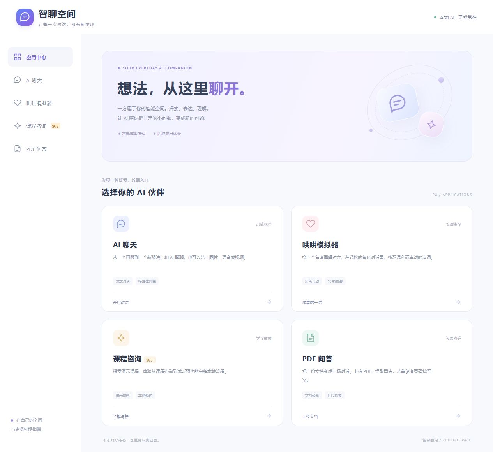

# 智聊空间 · Zhiliao Space

基于 **Vue 3、Spring Boot、Spring AI 与 Ollama** 的本地 AI 应用中心，支持多模态聊天、哄哄模拟器、演示课程预约和 PDF 问答。

项目采用 **frontend / backend 单仓库结构**：前端是可以修改和重新打包的 Vue 源码，后端仅提供接口，前端不再放入 Java 的 static 目录。



## 项目功能

| 应用 | 功能 |
| --- | --- |
| AI 聊天 | 中文流式回复、多轮上下文、历史恢复、图片理解、音频转写问答、视频关键帧与音轨分析 |
| 哄哄模拟器 | 自定义生气原因、角色对话、服务端计分、10 轮上限、胜负判定、重新开始和历史恢复 |
| 课程咨询（演示） | 演示课程介绍，课程/校区/称呼/电话分步预约、确认摘要、演示预约编号、取消预约 |
| PDF 问答 | 文字型 PDF 上传、逐页预览、原文件取回、片段检索、参考页码、恢复历史文档与问答 |
| 网页交互 | 独立路由、响应式布局、附件拖放、上传校验、加载及错误提示、停止显示回复 |

适合个人学习、课程展示与可信环境下的单机演示。**目前没有多用户登录和访问隔离**，预约不会提交给真实学校。模型输出请结合实际情况核实。

## 目录结构

```text
zhiliao-space/
├─ frontend/                     可编辑的 Vue 前端工程
│  ├─ src/
│  │  ├─ views/HomeView.vue       应用首页
│  │  ├─ views/ChatView.vue       聊天、游戏、咨询、PDF 页面
│  │  ├─ components/             图标等公共组件
│  │  ├─ composables/            会话、流式回复和历史状态
│  │  ├─ lib/api.js              接口请求、流式解码和文件校验
│  │  ├─ router.js               路由与应用配置
│  │  └─ style.css               公共样式与响应式布局
│  ├─ public/favicon.svg         蓝紫色对话图标
│  ├─ test/                      前端自动化检查
│  ├─ package.json
│  ├─ package-lock.json          npm 依赖锁定文件
│  └─ vite.config.js             开发/预览服务器与接口代理
├─ backend/
│  ├─ src/main/java/             接口、会话、预约、PDF 和媒体服务
│  ├─ src/main/resources/application.yml
│  ├─ src/test/java/             Java 测试
│  ├─ .mvn/、mvnw、mvnw.cmd      Maven Wrapper
│  └─ pom.xml
├─ tools/                        Python 媒体处理、启动与检查脚本
├─ deploy/                       Nginx 部署模板
├─ docs/                         前端说明与首页截图
├─ start.ps1 / stop.ps1          Windows 启动与停止入口
└─ README.md
```

## 技术栈

- 前端：Vue 3、Vue Router 4、Vite 8、原生 CSS。
- 后端：Java 17、Spring Boot 3.5.5、Spring AI 1.0.1、Apache PDFBox。
- 本地推理：Ollama；文字模型 `qwen2.5:1.5b`（约 986MB），视觉模型 `qwen3-vl:2b-instruct`（约 1.9GB）。
- 媒体：Python、faster-whisper、Whisper base（约 145MB）、PyAV、Pillow。
- 会话和预约：根目录 `data/` 中的本地文件，不依赖 MySQL。POM 保留原工程 MySQL 驱动依赖，但当前业务没有接入数据库。

模型文件体积不等于运行时内存/显存需求。视觉功能需要支持 Qwen3-VL 的 Ollama 版本。

## 环境准备

准备 JDK 17、Maven（或 Maven Wrapper）、**Node.js 22.12+ / 20.19+**、npm、Python 和 Ollama。媒体依赖使用 Python 3.13 验证。Nginx 为可选项。

在项目根目录执行：

```powershell
git clone https://github.com/Trappedqueens/zhiliao-space.git
cd zhiliao-space
python -m venv .venv
.\.venv\Scripts\python.exe -m pip install -r tools/media-requirements.lock.txt
ollama pull qwen2.5:1.5b
ollama pull qwen3-vl:2b-instruct
.\.venv\Scripts\python.exe tools/media.py --download
```

Whisper 下载至 `data/models/whisper-base/`。首次下载需要联网；模型、依赖环境和个人数据不在仓库中。

## 启动项目

### Windows 一键启动

先打开 Ollama，在项目根目录运行：

```powershell
.\start.ps1 -Build
```

脚本测试并构建前后端，然后分别启动后端 API 和前端预览服务器。打开 [http://localhost:5173/](http://localhost:5173/)。

- **5173 是网页入口**。
- **8080 仅提供后端 API**，例如 [功能限制接口](http://localhost:8080/ai/capabilities)。
- 后续无需构建时运行 `.\start.ps1`；停止使用 `.\stop.ps1`。
- 修改后重新构建前，先停止本项目。
- `-BackendOnly` 只启动接口，页面需要另行启动前端。
- 默认使用 Vite preview 提供构建结果，适合本机演示；正式静态部署使用 Nginx。

### 开发模式：修改 Vue 页面

先从项目根目录构建后端：

```powershell
mvn -f backend/pom.xml package
java -jar backend/target/AI-0.0.1-SNAPSHOT.jar
```

另开终端启动前端：

```powershell
cd frontend
npm ci
npm run dev
```

访问 [http://localhost:5173/](http://localhost:5173/)，修改 `frontend/src/` 中的 .vue、JS、CSS 文件即可查看变化。后端建议从仓库根目录启动，以便默认媒体工具、虚拟环境与数据路径正确。

没有全局 Maven 时，可在 `backend/` 中使用 `mvnw.cmd package`（Linux/macOS 使用 `./mvnw package`），再回根目录启动 JAR。Windows 脚本启动的进程由 PID 管理；手动终端启动的进程请在对应终端停止。

### 使用 Nginx

先停止占用 5173 的前端。指定已安装的 Nginx 目录：

```powershell
.\stop.ps1
.\start.ps1 -Build -NginxHome 'C:\tools\nginx'
```

脚本从 `deploy/nginx.conf.template` 生成当前电脑的 `deploy/nginx.conf`，使用项目独立运行目录：

- 静态目录：`frontend/dist/`。
- 页面路由：`try_files` 回退到 `index.html`，支持刷新子页面。
- 接口：`/api/` 转发至 `http://127.0.0.1:8080/`，去掉 `/api` 前缀。
- 支持流式回复与附件上传。
- 原 Nginx 安装目录、原有 html 与 conf 文件不会被替换。

Linux 的站点配置示例在 [deploy/nginx.site.conf](deploy/nginx.site.conf)，按实际部署位置修改。前端需要先运行 `npm ci && npm run build`，只部署 `frontend/dist/`，不需要上传 node_modules 或 Nginx 程序本体。

## 使用说明

**AI 聊天**：每次最多 3 个同类型附件。图片/音频单个不超过 10MB，音频不超过 180 秒；视频单个不超过 150MB、40 秒，抽样最多 4 帧。附件可拖入对话区。原生流式文本显示支持中文分块解码。停止显示回复可能仍有服务端处理，历史以服务端保存结果为准。

**哄哄模拟器**：填写生气原因，开始游戏后进行最多 10 轮对话。分数由服务端维护，角色台词由模型生成；模型离线时保留内置回复。结束后点击“重新开始”。

**课程咨询**：输入“预约试听”，依次选择课程、校区、称呼、电话，最后输入“确认预约”。可使用化名和演示号码 `13800000000`；输入“取消预约”退出。所有课程、价格、校区和编号仅为演示，不发送短信、不收费。

**PDF 问答**：新建对话后上传可提取文字的 PDF（最多 20MB、200 页、100 万文字）。左侧预览原文，右侧提问；窄屏上下排列。历史可恢复原文件。暂不支持扫描件与加密文件，回答只基于检索片段，参考页不是准确性保证。

## 配置与接口

后端配置：`backend/src/main/resources/application.yml`。可通过环境变量覆盖：

| 环境变量 | 默认值 | 用途 |
| --- | --- | --- |
| `OLLAMA_BASE_URL` | `http://localhost:11434` | 模型服务 |
| `TEXT_MODEL` | `qwen2.5:1.5b` | 文字模型 |
| `VISION_MODEL` | `qwen3-vl:2b-instruct` | 视觉模型 |
| `APP_DATA_DIR` | `./data` | 会话、预约和 PDF |
| `APP_MEDIA_PYTHON` | `.venv/Scripts/python.exe` | 媒体解释器，Linux 可改为 .venv/bin/python |
| `APP_MEDIA_SCRIPT` | `tools/media.py` | 媒体处理脚本 |
| `APP_WHISPER_MODEL_DIR` | `data/models/whisper-base` | Python 工具使用的 Whisper 模型目录 |

前端默认使用同源 `/api`；Vite 将其代理给 8080。参考 `frontend/.env.example`：`VITE_API_BASE` 控制浏览器请求前缀，`BACKEND_URL` 控制 Vite 代理目标。不要在任何 `VITE_` 变量中放密钥，因为它们会进入浏览器。

| 接口（后端原始路径） | 作用 |
| --- | --- |
| `POST /ai/chat` | multipart 正文，prompt / chatId / files |
| `POST /ai/game`、`POST /ai/service`、`POST /ai/pdf/chat` | 表单正文，prompt / chatId；流式文本 |
| `GET /ai/history/{type}` | 模块的会话 ID，按更新时间排序 |
| `GET /ai/history/{type}/{id}` | role/content 历史消息 |
| `POST /ai/pdf/upload/{id}` | multipart PDF，字段 file |
| `GET /ai/pdf/info/{id}` | PDF 文件名和会话 ID |
| `GET /ai/pdf/view/{id}` | 逐页预览 |
| `GET /ai/pdf/file/{id}` | 原 PDF |
| `GET /ai/capabilities` | 附件及页数限制 |

新前端统一以 POST 正文发送问题，旧 GET 对话入口保留兼容。

## 检查与测试

```powershell
# 后端测试（无需实际调用模型）
mvn -f backend/pom.xml test

# 前端检查与生产构建
cd frontend
npm ci
npm test
npm run build
```

前端检查覆盖中文/emoji 分块解码、HTTP 错误、停止流式读取、附件边界和 POST 请求正文；Java 检查覆盖应用上下文、持久化、模块隔离、预约确认和幂等性、游戏计分、PDF 检索与预览。

可选完整模型联调：从仓库根目录执行 `.\.venv\Scripts\python.exe tools/smoke_test.py --fixtures`，运行 `.\tools\make_speech_fixture.ps1`，然后 `.\.venv\Scripts\python.exe tools/smoke_test.py --media`。默认检查 5173 的前端代理；会生成仅包含合成数据的 smoke 会话，输出在 `target/`。

## 数据与迁移说明

- `data/` 包含聊天、完整预约资料、上传 PDF 和 Whisper 模型；不要公开上传。日志在根目录 `target/`。
- 当前没有登录、用户隔离、并发生产验证，不建议直接作为公网服务。
- Git 忽略 data、.venv、node_modules、dist、target、本机配置和日志；手动压缩整个目录不会应用这些排除规则。
- 本次 Vue 工程是依据已有页面功能和后端接口**重新建立的可维护源码**，不是从打包文件恢复出来的原始开发工程；实现说明见 [前端文档](frontend/README.md)。
- 原先提供的 Nginx html 目录只有构建产物，内含的第三方 WebViewer 不用于新版预览；新版使用本机 PDFBox 逐页图片，不需要上传该第三方程序。
- 旧版前端打包文件仍可在仓库历史中查阅；迁移不会删除 Git 历史。旧 8080 页面入口改为 5173，后端 API 路径保持兼容。
